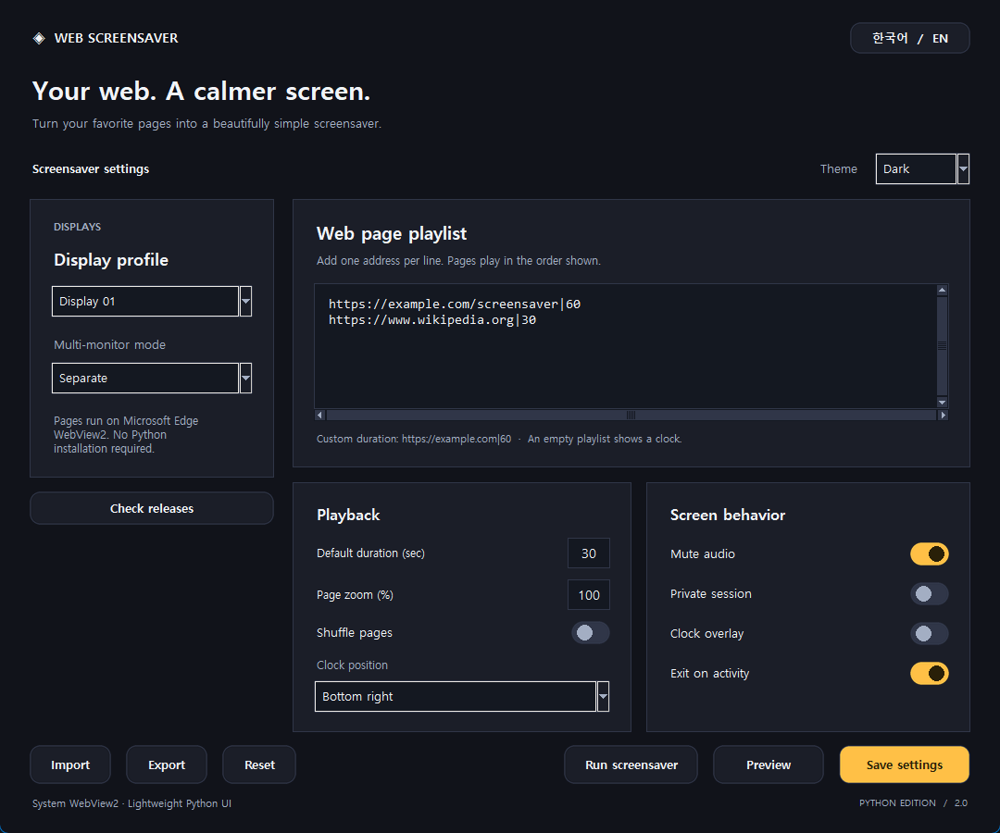
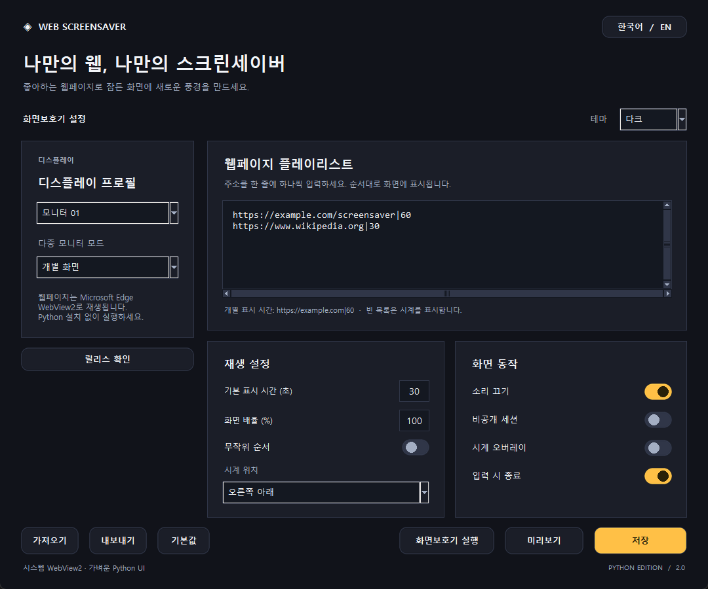
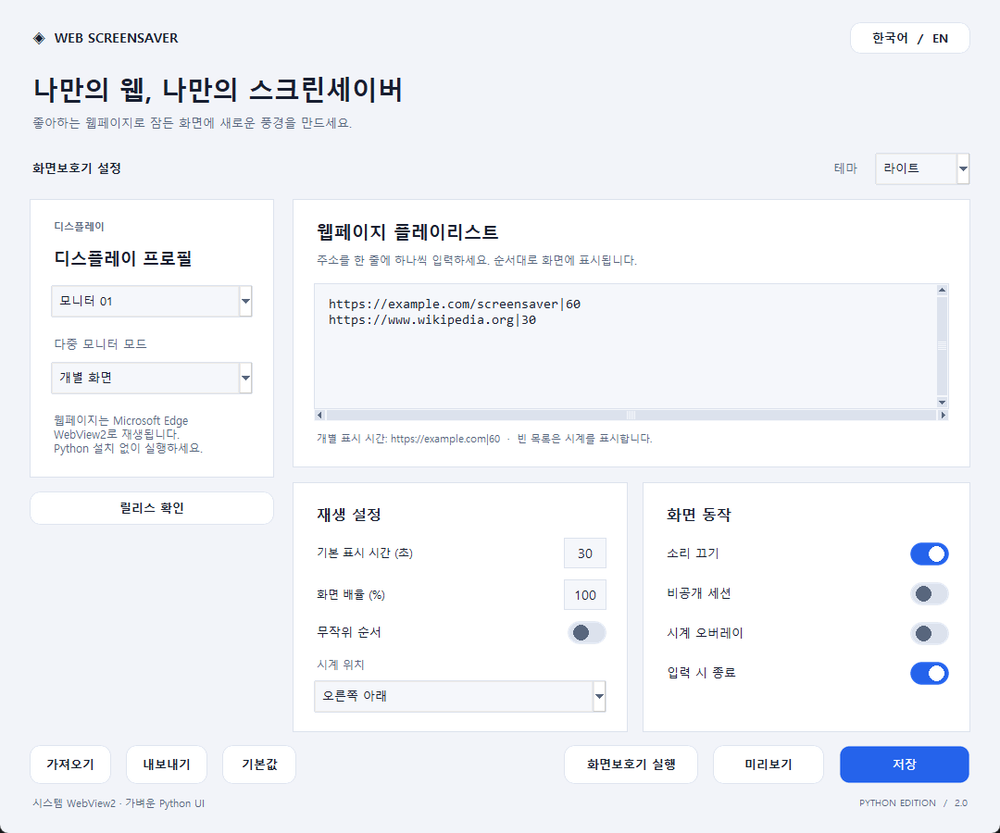

# Web Screensaver · Python Edition

- WebView2 web page screensaver for Windows, with no Python installation required.
- Separate, mirror and span display modes; per-display playlists, timing and zoom.
- Per-URL duration, shuffle, audio mute, private sessions and corner clock overlays.
- Offline clock, automatic reconnect, live preview and exit on user activity.
- English/Korean UI, system/light/dark themes, JSON backup and C# settings migration.

| Dark | Light |
| --- | --- |
|  |  |

# 웹 화면보호기 · Python 버전

- Python 설치 없이 실행하는 Windows WebView2 웹페이지 화면보호기.
- 개별·복제·통합 모니터 모드와 화면별 URL·표시 시간·확대 배율.
- URL별 표시 시간, 무작위 재생, 음소거, 비공개 세션, 모서리 시계.
- 오프라인 시계, 자동 재연결, 실시간 미리보기, 사용자 입력 시 종료.
- 한국어·영어, 시스템·다크·라이트 테마, JSON 백업, 기존 C# 설정 가져오기.

| 다크 | 라이트 |
| --- | --- |
|  |  |

[실행 및 빌드 / Usage and build](docs/USAGE.md)
